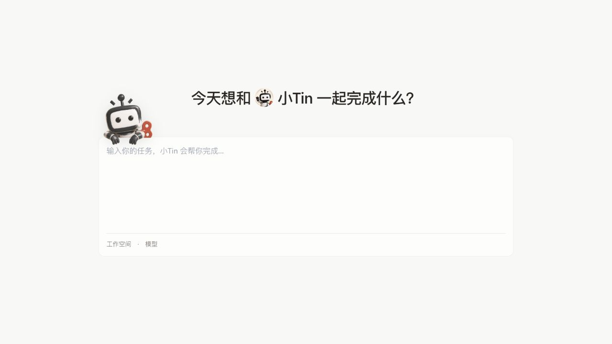
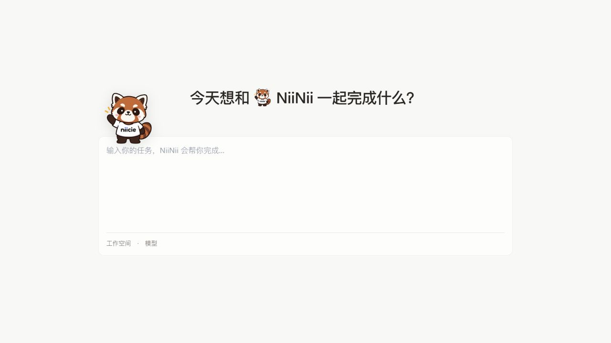
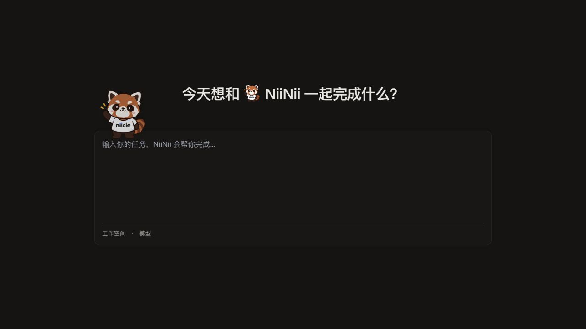

# NiiNii conversation identity

[中文](niinii-identity.md)

The default conversation companion and seven built-in roles use the NiiNii name and red panda artwork. Existing default Agents and unchanged factory role names are translated at display time. Custom names, uploaded avatars, and geometric function avatars are preserved without updating existing database records.

The welcome heading keeps its existing typography: `text-display`, a `1.25em` inline avatar, and the original spacing. Messages, role lists, group messages, and mention pickers retain their existing avatar sizes. The welcome companion remains `7rem` high, including its click feedback and input focus behavior.

Desktop shares `niinii-mascot.png`. The seven legacy avatar keys remain stable, with corresponding artwork replaced in iOS, Android, and the role asset directories. Application installation icons, Workspace icons, and stickers are outside this Agent avatar change.

## Artwork provenance

The requester supplied the NiiNii red panda PNG for this change. It is used byte for byte, without redrawing or modifying its contents. Copyright and permission to distribute the artwork remain for the provider to confirm. No externally downloaded artwork is introduced.

## Welcome component previews

These screenshots use the actual welcome companion, avatar components, Chinese copy, and shared design tokens, with a preview container standing in for the composer. They demonstrate content and sizing, rather than a full sign-in or model execution check.

At a 1280px preview width, both versions use a 32px heading, a 40×40px inline avatar, and a 112px-high welcome companion. Other responsive sizes continue to follow the existing CSS.

## Compatibility

- Saved historical messages, Agent IDs, avatar keys, and user-edited values remain unchanged.
- A unique Agent can be mentioned by its old name or NiiNii. Ambiguous member names are not guessed; the picker can still insert an explicit ID.
- Failed custom Agent avatars fall back to NiiNii. Human member and Workspace avatar behavior is preserved.
- Mobile changes replace only the seven legacy images, with no layout or protocol changes. iOS and Android builds were not run for this change.
